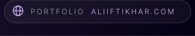
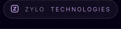
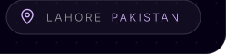

 

---

### 👋 About me

I'm a **full-stack engineer and backend lead at [Zylo Technologies](https://github.com/zylo-solution)**. I turn business problems into shipped software: scoping with clients, designing the architecture, and leading the team that builds it.

I care about the part of engineering that happens *before* the code: understanding the business, communicating clearly, and prompting AI tools well. Strong fundamentals plus those skills are what make a developer valuable.

### 🔭 What I'm working on

| | |
|---|---|
| 🚚 **Zylo Dispatch** | Product owner and backend lead: sales modules, AI outbound calling (Vapi), audit trails, and a documented API. |
| 🧠 **ZARM** | AI-readiness assessment platform for organizations, built on a questionnaire engine and consultant-reviewed reports. |
| 🍯 **Papayo** | AI product work with the Papayo team. |
| 🌯 **Macroline** | My micro-SaaS side project: a Chipotle-style macro and calorie calculator. [Try it](https://macroline-calculator.vercel.app) |

### 🎓 Mentorship

I run the **full-stack internship program at Zylo**. I teach interns to think like consultants, not just coders: ask the right questions, understand the client, communicate well, and use AI as a force multiplier.

### 🛠️ Tech I work with

### 📊 GitHub stats

### 🤝 Let's work together

I take on client projects: web platforms, AI integrations, and backend systems. If you have something you want built properly, get in touch.

